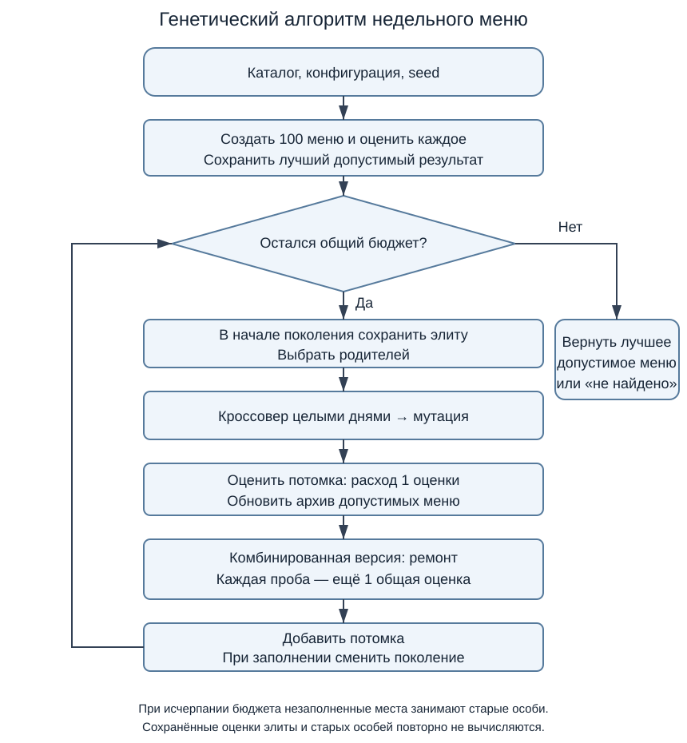

# Лабораторная работа №2

**Дисциплина:** «Эволюционное программирование и генетические алгоритмы»  
**Тема:** Генетический алгоритм для дискретной задачи с ограничениями  
**Группа:** 507  
**Вариант:** 20 — формирование меню на неделю

## 1. Цель работы

Разработать генетический алгоритм для составления недельного меню, выбрать дискретное представление решения и исследовать влияние обработки ограничений и операторов мутации на результат поиска.

## 2. Постановка задачи

Номер варианта определяется по формуле:

$$V=1+((17N+7Q+Y)\bmod20).$$

При N = 29, Q = 0 и Y = 26 получаем V = 20.

Необходимо составить меню на 7 дней из 30 готовых блюд с минимальной суммарной стоимостью. На каждый день выбирается набор блюд без разделения на приёмы пищи. Одно блюдо можно включить не более одного раза в день.

В работе приняты следующие ограничения:

| Параметр | Значение |
|---|---:|
| Калорийность каждого дня | 1800–2200 ккал |
| Бюджет на неделю | Не более 3500 ₽ |
| Количество различных блюд за неделю | Не менее 15 |
| Частота одного блюда | Не более 3 дней за неделю |

Сравниваются две стратегии обработки ограничений, два оператора мутации и случайный поиск с ремонтом. Для каждой конфигурации выполняется 20 независимых запусков.

## 3. Исходные данные

Каталог `data/dishes.csv` содержит 30 блюд. Для каждого указаны идентификатор, название, масса порции, стоимость и калорийность. Цены хранятся в целых копейках, калорийность — в целых килокалориях.

Данные синтетические. В `data_setup.py` заданы базовые характеристики блюд. При генерации к калорийности добавляется случайное значение от −20 до 20 ккал с шагом 5, к цене — целое число от −8 до 8 рублей. Используется seed 290026; масса порции остаётся постоянной. Итоговый каталог одинаков для всех экспериментов.

Строка исходного шаблона имеет вид:

```python
("Овсяная каша с бананом", 300, 430, 65)
```

Значения после названия означают массу порции 300 г, базовую калорийность 430 ккал и базовую цену 65 ₽. Поиск использует значения из сформированного CSV.

## 4. Математическая модель и представление решения

Обозначим через x[d, i] выбор блюда i в день d:

$$x_{d,i}\in\{0,1\},\qquad d=1,\ldots,7,\quad i=1,\ldots,30.$$

Значение 1 означает включение одной порции, 0 — отсутствие блюда. Особь представляет собой матрицу 7 × 30. Она эквивалентна целочисленному вектору из 210 элементов, а каждая строка задаёт множество блюд одного дня.

Генотип — бинарная матрица. Фенотип — соответствующее недельное меню. При декодировании единицы каждой строки заменяются названиями блюд и рассчитываются дневные суммы.

Пусть c_i — цена порции в копейках, k_i — её калорийность. Целевая функция:

$$C(x)=\sum_{d=1}^{7}\sum_{i=1}^{30}c_i x_{d,i}\longrightarrow\min.$$

Дневная калорийность и частота блюда:

$$K_d=\sum_i k_i x_{d,i},\qquad f_i=\sum_d x_{d,i}.$$

Число различных блюд U — количество индексов i, для которых f_i > 0. Ограничения имеют вид:

$$1800\le K_d\le2200\quad\text{для каждого дня},$$
$$C(x)\le350000,\qquad U\ge15,\qquad f_i\le3\quad\text{для каждого блюда}.$$

Бинарное кодирование непосредственно описывает выбор порций и не допускает повторения блюда в одном дне. До проверки остальных ограничений пространство поиска содержит 2^210 вариантов, поэтому полный перебор для основной задачи непрактичен.

## 5. Оценка решений и обработка ограничений

### 5.1. Штрафная оценка

Введём величины нарушений:

- a_d = max(0, 1800 − K_d) — недостаток калорий;
- b_d = max(0, K_d − 2200) — избыток калорий;
- b_C = max(0, C − 350000) — превышение бюджета;
- b_U = max(0, 15 − U) — недостаток разнообразия;
- b_i = max(0, f_i − 3) — превышение частоты блюда.

Суммарное нормированное нарушение:

$$v(x)=\frac{\sum_d(a_d+b_d)}{1800}+\frac{b_C}{350000}+\frac{b_U}{15}+\frac{\sum_i b_i}{3}.$$

Для отбора используется оценка:

$$F(x)=\frac{C(x)}{350000}+10v(x).$$

Меньшее значение F считается лучшим. При равенстве сравниваются нарушение v, затем стоимость C. Допустимое меню имеет v = 0. Среди допустимых решений минимизация F совпадает с минимизацией стоимости.

Недопустимое меню с небольшим нарушением может получить хорошую штрафную оценку. Поэтому лучшее допустимое решение сохраняется отдельно от текущей популяции.

### 5.2. Ремонт со штрафами

В комбинированной стратегии после оценки потомка выполняется ремонт. Последовательно рассматриваются избыточные повторы, недостаток калорий, избыток калорий, недостаток разнообразия и превышение бюджета. В зависимости от нарушения предлагается добавить, удалить или заменить блюдо.

Предложенное меню оценивается заново. Изменение принимается, если оно уменьшает v, а при равном v — снижает стоимость. Ремонт заканчивается после получения допустимого меню, 100 попыток или исчерпания общего вычислительного бюджета. Если нарушения остаются, решение участвует в отборе с той же штрафной оценкой F.

Таким образом, сравниваемые стратегии различаются наличием ремонта; формула оценки и правило отбора одинаковы.

## 6. Генетический алгоритм

Начальная популяция состоит из 100 случайных меню. Каждый элемент матрицы независимо принимает значение 1 с вероятностью:

$$p=\min\left(1,\frac{2000}{\sum_i k_i}\right).$$

Это даёт ожидаемую калорийность дня около 2000 ккал, но не гарантирует допустимость. Для одного seed все версии ГА начинают с одинаковой популяции.

**Отбор.** Для каждого родителя случайно выбираются три разные особи. Побеждает особь с наименьшим ключом (F, v, C). Между турнирами участники могут повторяться.

**Кроссовер.** С вероятностью 0,9 создаётся потомок, каждый день которого с равными вероятностями берётся от одного из двух родителей. Иначе копируется первый родитель. Такой оператор сохраняет дневные наборы, но может нарушать недельный бюджет, частоты и разнообразие.

**Битовая мутация.** Каждый из 210 битов меняется на противоположный с вероятностью 1/210. Ожидаемое число изменений равно одному, но в конкретном потомке может измениться несколько битов или ни одного.

**Мутация заменой.** С вероятностью 0,5 в случайном дне одно выбранное блюдо заменяется отсутствующим. Меняются два бита; ожидаемое число изменённых битов также равно одному, если замена возможна. Оператор сохраняет количество блюд в дне. Битовая мутация может его менять.

**Смена поколений.** Две лучшие особи переносятся без изменений, остальные места заполняются потомками. Лучшее допустимое меню сохраняется отдельно. В неполном последнем поколении свободные места заполняются лучшими оставшимися особями прежней популяции.

**Остановка.** Поиск завершается после 50 000 оценок меню, включая проверки внутри ремонта. Возвращается лучшее допустимое решение за весь запуск.



Программа написана на Python. В `model.py` находятся расчёты и проверка ограничений, в `algorithm.py` — операторы и цикл поиска, в `run.py` — запуск экспериментов, в `analysis.py` — статистика и графики. Используются NumPy и Matplotlib.

## 7. Проверка корректности

Для проверки ограничений подготовлены два допустимых и два недопустимых решения. Допустимые примеры получены отдельно с seed 290027 и не используются для инициализации ГА. Матрицы примеров сохранены в `data/examples.json`.

| Пример | Калории по дням, ккал | Цена, ₽ | Разных блюд | Максимальная частота | Допустимость |
|---|---|---:|---:|---:|---|
| 1 | 1850, 2105, 1965, 2100, 2155, 1845, 2090 | 3107 | 22 | 3 | Да |
| 2 | 2080, 1950, 1955, 1950, 1820, 2110, 2140 | 3197 | 18 | 3 | Да |
| Пустое меню | 0, 0, 0, 0, 0, 0, 0 | 0 | 0 | 0 | Нет |
| Повторение первого дня примера 1 | 1850 во всех днях | 3178 | 4 | 7 | Нет |

Пустое меню нарушает ограничения калорийности и разнообразия. Повторение одного дня нарушает разнообразие и частоты блюд. Первые два примера подтверждают совместимость выбранных ограничений.

Автоматические тесты проверяют расчёт стоимости и калорий, граничные значения ограничений, сохранение бинарности, неизменность родителей, воспроизводимость seed и соблюдение бюджета, включая неудачные попытки ремонта. Дополнительно проверяются сохранённые меню и статистика серии. Все 12 тестов проходят.

## 8. Условия эксперимента

| Параметр | Значение |
|---|---:|
| Размер популяции | 100 |
| Размер турнира | 3 |
| Вероятность кроссовера | 0,9 |
| Вероятность изменения каждого бита | 1/210 |
| Вероятность замены | 0,5 на потомка |
| Количество элитных особей | 2 |
| Коэффициент штрафа | 10 |
| Предел попыток ремонта | 100 |
| Бюджет одного запуска | 50 000 оценок |
| Число запусков конфигурации | 20 |
| Seed запусков | 0–19 |

Исследованы пять конфигураций: штрафы с битовой мутацией, штрафы с заменой, ремонт со штрафами и битовой мутацией, ремонт со штрафами и заменой, случайный поиск с ремонтом.

Базовый метод независимо создаёт случайные меню и применяет ту же процедуру ремонта, без отбора и наследования. Это позволяет сравнить ГА с простым поиском, который также способен исправлять нарушения.

Одна оценка — полный расчёт характеристик одного меню. В лимит входят начальная популяция, потомки и все пробы ремонта, в том числе отклонённые. Уже известные оценки элиты повторно не вычисляются. Бюджеты одинаковы, но число поколений и время работы могут различаться.

Всего выполнено 100 запусков и 5 000 000 оценок. Для анализа ремонта сравниваются конфигурации с одинаковой мутацией; для анализа мутации — с одинаковой обработкой ограничений.

## 9. Результаты и анализ

### 9.1. Сравнение методов

Во всех 100 запусках найдено допустимое решение. Статистика рассчитана по стоимости лучшего допустимого меню каждого запуска. Стандартное отклонение — выборочное.

| Метод | Успешные запуски | Минимум, ₽ | Среднее, ₽ | Медиана, ₽ | Станд. отклонение, ₽ | Максимум, ₽ |
|---|---:|---:|---:|---:|---:|---:|
| Штрафы, биты | 20/20 | 2337 | 2382,00 | 2386,00 | 27,29 | 2442 |
| Штрафы, замена | 20/20 | 2265 | 2312,65 | 2314,00 | 41,16 | 2421 |
| Ремонт + штрафы, биты | 20/20 | 2260 | 2272,25 | 2272,00 | 7,36 | 2287 |
| Ремонт + штрафы, замена | 20/20 | 2256 | 2270,60 | 2272,50 | 6,60 | 2281 |
| Случайный поиск с ремонтом | 20/20 | 2598 | 2691,60 | 2694,50 | 34,07 | 2743 |


Добавление ремонта снизило среднюю стоимость на 109,75 ₽ при битовой мутации и на 42,05 ₽ при замене. Одновременно уменьшился разброс результатов. Ремонт занял в среднем 33 022,6 и 23 813,45 оценки соответственно, поэтому при одинаковом бюджете число поколений уменьшилось с 510 до средних 172,75 и 266,60.

Без ремонта замена оказалась лучше битовой мутации по средней стоимости на 69,35 ₽. С ремонтом разница составила только 1,65 ₽, причём медиана немного лучше у битовой мутации. Поэтому выраженного преимущества одной мутации при использовании ремонта в этой серии не наблюдается.

Средняя стоимость случайного поиска с ремонтом составила 2691,60 ₽. Комбинированный ГА с заменой уменьшил её на 421 ₽. Даже лучший результат базового метода, 2598 ₽, хуже худшего результата каждой конфигурации ГА в проведённой серии.

Среднее время запуска составило 2,53; 2,89; 3,72; 4,70 и 6,99 с в порядке строк таблицы. Эти значения относятся к машине, на которой выполнялась серия; основным ресурсом сравнения служит число оценок.

### 9.2. Сходимость


На верхнем графике показаны средняя стоимость и диапазон от минимума до максимума среди запусков, уже нашедших допустимое меню. На нижнем — доля таких запусков. До первого допустимого решения стоимость отсутствует и не заменяется нулём.

Комбинированные методы достигают более низких значений стоимости. Кривые постепенно выравниваются, что указывает на замедление улучшений при выбранных параметрах поиска.

### 9.3. Лучшее меню

Лучшее решение получено методом «ремонт + штрафы, замена» при seed 2. Стоимость недели — **2256 ₽**, использовано **15 различных блюд**, каждое встречается не более чем в **3 днях**.

| День | Блюда и масса порций | Калорийность, ккал | Стоимость, ₽ |
|---|---|---:|---:|
| 1 | Блины с творогом (250 г); Гороховый суп (400 г); Кускус с овощами (300 г); Пшённая каша с тыквой (300 г) | 1805 | 328 |
| 2 | Овсяная каша с бананом (300 г); Блины с творогом (250 г); Перловка с грибами (300 г); Пшённая каша с тыквой (300 г) | 1820 | 287 |
| 3 | Чечевица с овощами (300 г); Блины с творогом (250 г); Перловка с грибами (300 г); Салат с фасолью и сухариками (300 г) | 1805 | 350 |
| 4 | Сырники со сметаной (250 г); Вареники с картофелем (300 г); Пельмени со сметаной (250 г) | 1800 | 347 |
| 5 | Овсяная каша с бананом (300 г); Рис с овощами (300 г); Перловка с грибами (300 г); Вареники с картофелем (300 г) | 1815 | 292 |
| 6 | Гречка с грибами (300 г); Рис с овощами (300 г); Картофельная запеканка (300 г); Вареники с картофелем (300 г) | 1805 | 340 |
| 7 | Овсяная каша с бананом (300 г); Паста с томатным соусом (300 г); Кускус с овощами (300 г); Пшённая каша с тыквой (300 г) | 1830 | 312 |

Во всех днях выполнен диапазон 1800–2200 ккал. Стоимость меньше бюджета 3500 ₽. Калорийность близка к нижней границе, поскольку алгоритм минимизирует цену, а не отклонение от 2000 ккал.

### 9.4. Оценка качества решения

Для дополнительной оценки качества рассмотрена ослабленная задача: разрешены дробные порции, сохранены суммарная потребность 12 600 ккал и предел трёх порций каждого блюда за неделю, исключены дневные ограничения и требование разнообразия. Блюда выбираются по возрастанию цены одной килокалории до достижения нужной суммы калорий.

Минимум этой задачи является нижней границей стоимости исходной задачи, поскольку ограничения ослаблены. Полученная граница с округлением вниз до копейки равна 2185,39 ₽. Лучшее допустимое меню дороже неё на 70,61 ₽, или 3,23%. Это позволяет оценить результат как близкий к нижней границе, но не доказывает достижение глобального минимума.

## 10. Выводы

Разработан генетический алгоритм для выбора недельного меню с бинарным представлением. Реализованы турнирный отбор, кроссовер по дням, два оператора мутации, штрафная оценка и ремонт решений.

На выбранном наборе данных добавление ремонта улучшило среднюю стоимость и снизило разброс результатов. Замена блюда дала преимущество перед битовой мутацией без ремонта, однако при ремонте различие между мутациями оказалось небольшим.

Генетический алгоритм превзошёл случайный поиск с ремонтом при одинаковом числе оценок. Лучшее найденное меню стоит 2256 ₽, выполняет все ограничения и превышает нижнюю границу стоимости на 3,23%. Все конфигурации нашли допустимые решения в 20 из 20 запусков.

Выводы относятся к данному каталогу, ограничениям и бюджету 50 000 оценок. Генетический алгоритм не гарантирует точный оптимум. Дальнейшее исследование может включать изменение веса штрафа, размера популяции и проверку на других каталогах блюд.

## Источник задания

Душкин Р. В. Дисциплина «Эволюционное программирование и генетические алгоритмы». Комплекс лабораторных работ. Общие положения и лабораторная работа №2.
