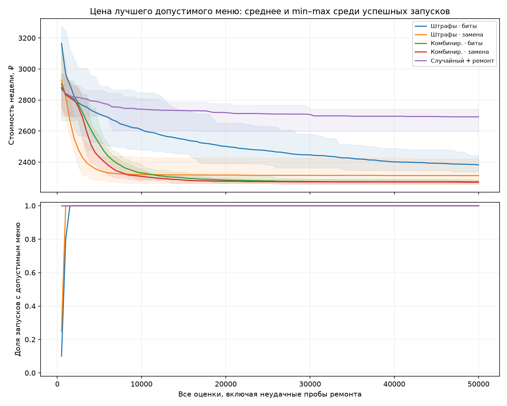
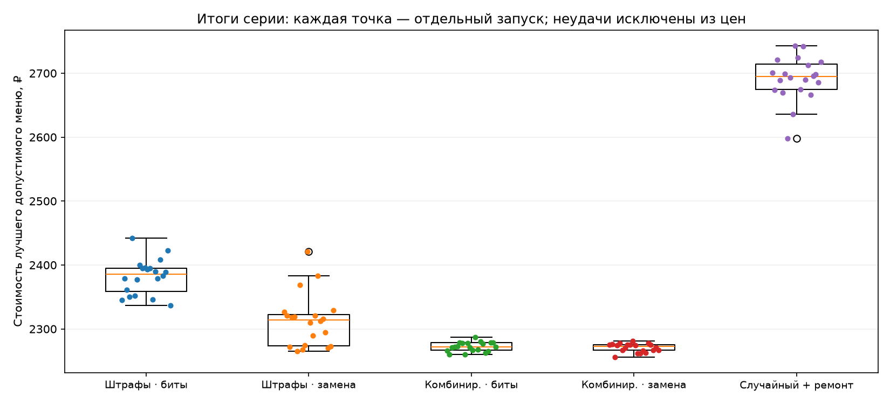
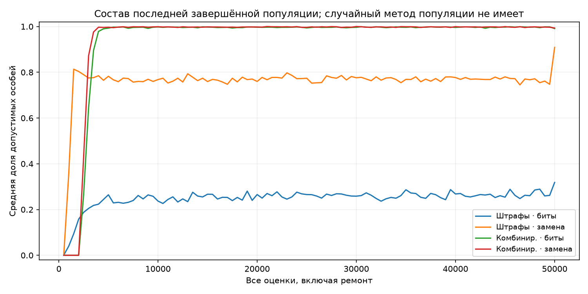
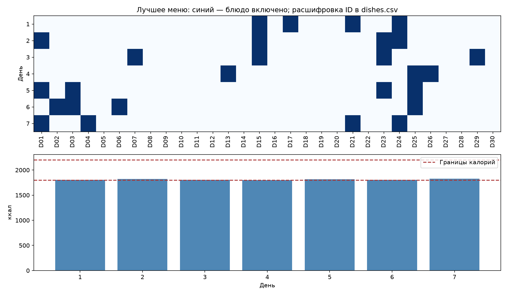

# Фактические результаты серии

Цены приведены только для допустимых результатов. Std — выборочное, ddof=1.

| Метод | Успехи | Best, ₽ | Mean, ₽ | Median, ₽ | Std, ₽ | Worst, ₽ | Среднее время, с |
|---|---:|---:|---:|---:|---:|---:|---:|
| penalty_bit | 20/20 | 2337.00 | 2382.00 | 2386.00 | 27.29 | 2442.00 | 2.53 |
| penalty_swap | 20/20 | 2265.00 | 2312.65 | 2314.00 | 41.16 | 2421.00 | 2.89 |
| combined_bit | 20/20 | 2260.00 | 2272.25 | 2272.00 | 7.36 | 2287.00 | 3.72 |
| combined_swap | 20/20 | 2256.00 | 2270.60 | 2272.50 | 6.60 | 2281.00 | 4.70 |
| random_repair | 20/20 | 2598.00 | 2691.60 | 2694.50 | 34.07 | 2743.00 | 6.99 |

| Метод | Среднее число проб ремонта | Среднее число поколений |
|---|---:|---:|
| penalty_bit | 0.0 | 510.0 |
| penalty_swap | 0.0 | 510.0 |
| combined_bit | 33022.6 | 172.8 |
| combined_swap | 23813.5 | 266.6 |
| random_repair | 48385.2 | 0.0 |

Нижняя граница стоимости ослабленной задачи: **2185.39 ₽**.
Лучший результат: **2256.00 ₽**, combined_swap, seed 2.
Превышение нижней границы: **3.23%**; это не доказательство оптимальности.

