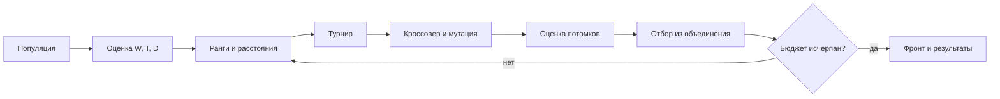
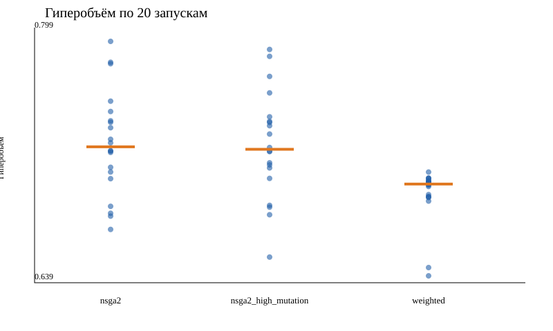
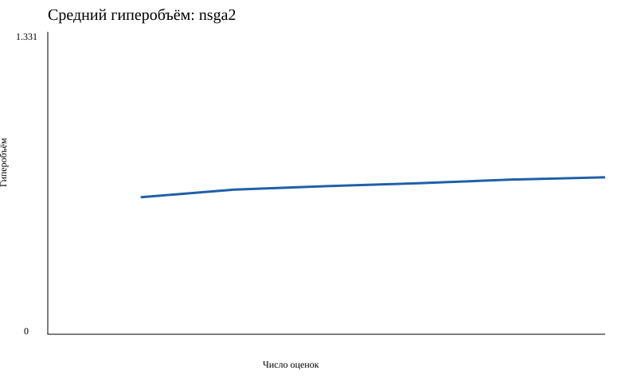
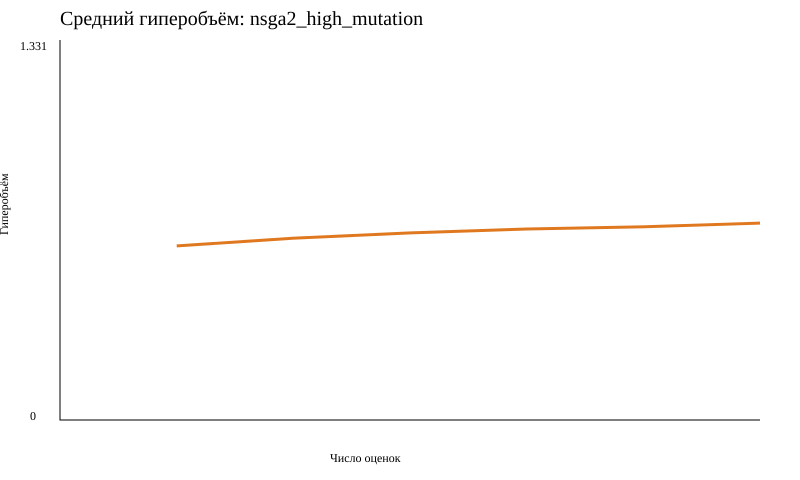
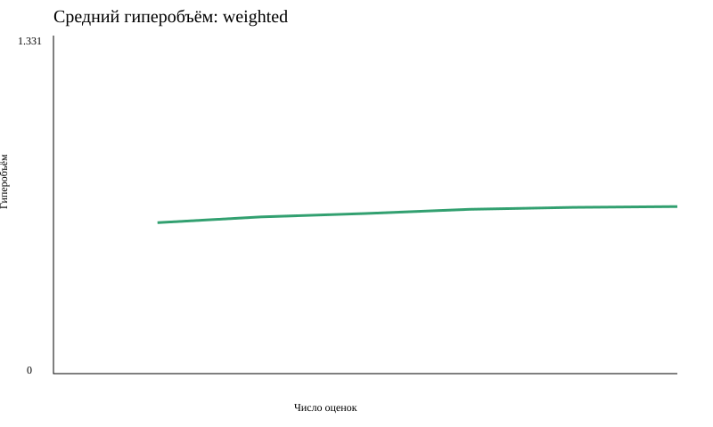
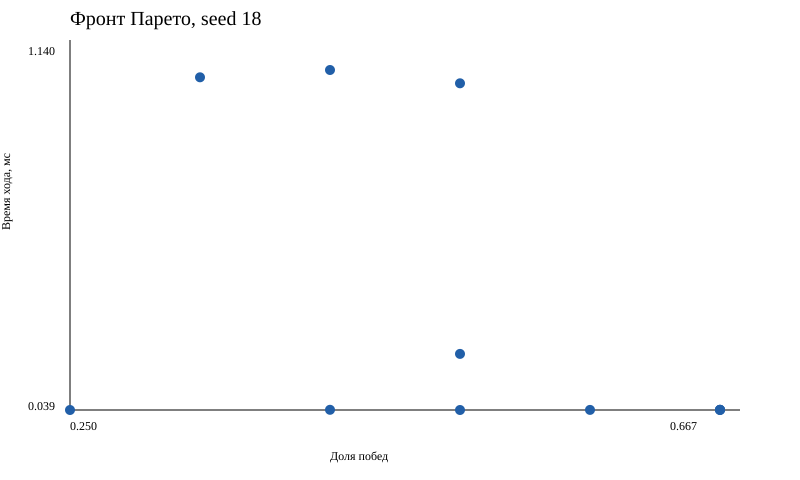
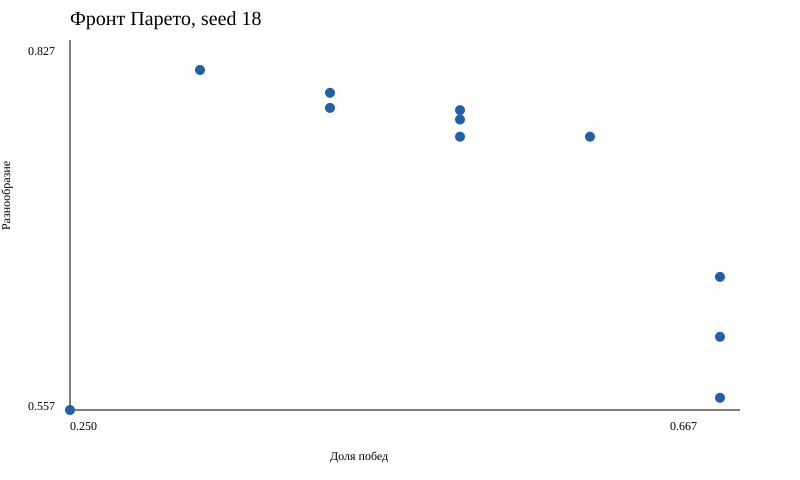
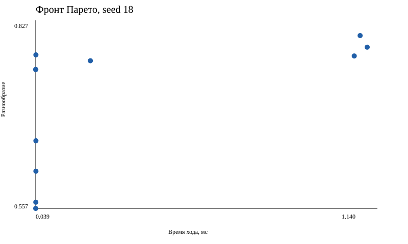

# Лабораторная работа №3. Настройка параметров игрового ИИ

**Дисциплина:** «Эволюционное программирование и генетические алгоритмы». **Группа:** 507. **Вариант:** 20, трек A.

## Постановка

При N = 29, Q = 0, Y = 26 номер варианта равен 1 + ((17·29 + 7·0 + 26) mod 20) = 20. По методичке требуется настроить игровой ИИ с тремя целями: больше побед, меньше времени на решение, выше разнообразие стратегии. Для опыта выбраны крестики-нолики 3 × 3. Это учебная игровая модель, позволяющая многократно оценивать агентов на одних и тех же условиях. Размер поля и все параметры опыта выбраны для этой работы.

Особь задаёт одного агента: `x = (d, w1, w2, w3, w4, epsilon)`. Глубина поиска `d` принимает значения 1, 2 или 3. Четыре веса лежат в [0, 1], вероятность случайного допустимого хода `epsilon` лежит в [0, 0.5]. Фенотипом служит алгоритм выбора хода с этими параметрами. Кандидаты всегда допустимы: целая глубина и границы вещественных генов поддерживаются инициализацией и операторами.

## Игровая модель и оценка

Для нетерминальной позиции считаются линии из одного или двух знаков агента без знаков соперника (`A1`, `A2`) и аналогичные линии соперника (`B1`, `B2`). Эвристика равна `(w1·A1 + w2·A2 − w3·B1 − w4·B2)/16`. Победа оценивается как `+1`, поражение как `−1`, ничья как `0`. В minimax агент максимизирует оценку, соперник минимизирует. Проверка конца партии выполняется до ограничения глубины. Деление на 16 удерживает оценку нетерминального состояния по модулю меньше 1, так что терминальный выигрыш имеет приоритет. Minimax и обработка правил реализованы самостоятельно.

При выборе действия с вероятностью `epsilon` берётся случайный допустимый ход. Иначе ход равномерно выбирается среди лучших по minimax. Сравнение равных оценок использует допуск `10⁻¹²`.

Три противника: случайный игрок, тактический игрок (сначала победа, затем блокировка победы соперника) и фиксированный minimax с глубиной 3 и четырьмя единичными весами. Агент играет каждым знаком. Общий манифест партий с раздельными seed игроков сохранён в `data/train.json`; новый манифест для итоговой проверки находится в `data/test.json`.

## Цели

Доля побед `W = число побед / число партий`; ничьи учитываются отдельно. На обучении каждый агент проходит 12 партий: 2 для каждой пары «противник × знак». На итоговом тесте 60 новых партий. Малое число партий создаёт грубую оценку W с шагом 1/12; это ограничение выбранного бюджета.

Время `T` измеряется через `perf_counter_ns` на одинаковом наборе 12 сохранённых позиций. После прогрева выполняются 2 повторных прохода; используется медиана времени одного решения. На итоговом тесте 24 другие позиции. В таблицах время указано в миллисекундах. Число узлов minimax сохраняется как дополнительная характеристика, но не подменяет реальное время. На время влияют загрузка машины и шум таймера.

Разнообразие поведения `D` измеряется средней нормированной энтропией распределения вероятностей ходов на тех же позициях. Если допустимых ходов `k`, а лучших по minimax `g`, то лучший ход получает вероятность `epsilon/k + (1−epsilon)/g`, остальные получают `epsilon/k`. Энтропия каждой позиции делится на `ln(k)`, затем усредняется. Значение 1 соответствует равномерному выбору среди доступных ходов. Высокое D само по себе не означает сильную игру.

Три цели сведены к направлению минимизации без потери многокритериальности: `f = (1−W, T/(T+T0), 1−D)`. `T0` является заранее измеренным временем фиксированного агента и хранится в `data/time_scale.json`. Временное преобразование монотонно и сохраняет отношения доминирования. Доминирование означает, что решение не хуже по всем трём целям и строго лучше хотя бы по одной.

## Алгоритм и сравнение

Собственный NSGA-II выполняет недоминируемую сортировку и рассчитывает расстояние до скопления внутри каждого фронта. Родители выбираются бинарным турниром по рангу и расстоянию; следующая популяция набирается из объединения родителей и потомков. Равномерный кроссовер обменивает координаты двух родителей. Мутация меняет глубину на другую допустимую или добавляет нормальное приращение к весу/`epsilon` с возвратом в границы. Эти операторы подходят смешанному представлению и не меняют родителей на месте.

Сравниваются NSGA-II с вероятностью мутации `1/6`, NSGA-II с вероятностью `2/6` и генетический алгоритм со взвешенной суммой целей. В последнем заранее заданы 6 наборов весов: `(1,0,0)`, `(0,1,0)`, `(0,0,1)`, `(1/3,1/3,1/3)`, `(0.6,0.2,0.2)`, `(0.2,0.4,0.4)`. На каждый вес приходится 40 оценок, всего 240 на повтор. NSGA-II также получает 240 оценок. Базовый метод применяет те же операторы и элитный отбор по сумме. Конечное число весов и короткие поиски ограничивают сравнение; выводы о всех возможных взвешенных методах из него не следуют.

## Методика эксперимента

Размер популяции 24, вероятность кроссовера 0.9, стандартные отклонения мутации весов 0.1 и `epsilon` 0.05. Выполняются 20 независимых seed для каждого метода. Инициализация входит в бюджет. Одна оценка содержит все партии, измерения времени и вычисление энтропии. Повторный генотип тоже учитывается. Для взвешенного метода шесть поисков вместе расходуют те же 240 оценок. Отдельно записаны время всей серии и полные данные каждого запуска. Одинаковое число оценок не означает равного общего времени, поскольку глубины поиска различаются.

Показатель качества множества решений: приближённый гиперобъём в пространстве трёх нормированных целей относительно точки `(1.1,1.1,1.1)`. Его оценивают 20 000 одинаковых для всех методов равномерных точек. Погрешность Монте-Карло сохраняется для каждого запуска. Этот показатель сравнивает найденные множества, но не доказывает достижения истинного фронта Парето.

Перед серией выполнены тесты правил, minimax, энтропии, доминирования, операторов, повторяемости игровых исходов и точного числа вызовов оценки. Для типичного изображения фронта выбирается запуск с медианным гиперобъёмом. Три агента из его недоминируемого множества выбираются по заранее заданным правилам: максимум побед, минимум времени среди оставшихся, затем минимум худшей нормированной цели среди остальных. Их итоговая проверка проводится на отдельных партиях и позициях.

## Результаты

Числа ниже заполняются только из завершённой серии. Машиночитаемые первичные результаты находятся в `results/experiment/run_*.json`, сводка в `runs.csv` и `summary.json`.

| Метод | Лучший | Среднее | Медиана | Ст. откл. | Худший | Среднее время запуска, с |
|---|---:|---:|---:|---:|---:|---:|
| nsga2 | 0.7990 | 0.7291 | 0.7269 | 0.0357 | 0.6703 | 12.2 |
| nsga2_high_mutation | 0.7935 | 0.7279 | 0.7251 | 0.0365 | 0.6514 | 13.4 |
| weighted | 0.7096 | 0.6943 | 0.7013 | 0.0189 | 0.6385 | 14.8 |

Гиперобъём оценён одними и теми же 20 000 случайных точек. Средняя стандартная ошибка оценки по запускам: nsga2 0.0047, nsga2_high_mutation 0.0047, weighted 0.0047.

Характерные решения взяты из запуска NSGA-II с seed 18, ближайшего к медианному гиперобъёму. Время приведено в миллисекундах.

| Смысл | d | w1 | w2 | w3 | w4 | epsilon | W обучение | T, мс | D | W тест | T тест, мс | D тест |
|---|---:|---:|---:|---:|---:|---:|---:|---:|---:|---:|---:|---:|
| Больше побед | 1 | 0.41 | 0.59 | 0.08 | 0.70 | 0.29 | 0.667 | 0.040 | 0.567 | 0.417 | 0.039 | 0.586 |
| Быстрее | 1 | 0.47 | 0.21 | 0.10 | 0.25 | 0.29 | 0.250 | 0.039 | 0.557 | 0.183 | 0.036 | 0.594 |
| Компромисс | 1 | 0.48 | 0.65 | 0.11 | 0.90 | 0.38 | 0.667 | 0.040 | 0.663 | 0.350 | 0.037 | 0.678 |

Для каждого выбранного агента сырые счётчики побед, ничьих и поражений по противнику и знаку находятся в соответствующем `run_*.json`. Тестовые значения получены на новых партиях и позициях; они не использовались при поиске.

Средняя тестовая доля побед выбранных по одному правилу агентов за 20 запусков:

| Метод | Больше побед | Быстрее | Компромисс |
|---|---:|---:|---:|
| nsga2 | 0.359 | 0.262 | 0.306 |
| nsga2_high_mutation | 0.367 | 0.242 | 0.303 |
| weighted | 0.385 | 0.247 | 0.307 |

## Выводы и ограничения

Средний гиперобъём составил 0.7291 при `p_m = 1/6`, 0.7279 при `p_m = 2/6` и 0.6943 у взвешенного метода. Изменение вероятности мутации на этой модели связано с изменением среднего результата на -0.0012; разброс по 20 запускам указан в таблице, поэтому не следует приписывать разницу одной только мутации без учёта случайности и шума времени. Сравнение с взвешенной суммой ограничено шестью выбранными наборами весов и выделенным каждому поиску бюджетом. У характерных решений W на обучении меняется от 0.250 до 0.667, T от 0.039 до 0.040 мс, D от 0.557 до 0.663. По обучающей оценке первая особь чаще побеждает, вторая имеет минимальное измеренное время, третья даёт иной компромисс с большей энтропией ходов. Итоговая проверка дала W от 0.183 до 0.417. У агента с максимальной обучающей долей побед она упала с 0.667 до 0.417. Средняя тестовая доля побед выбранных по победам агентов составила 0.359 для NSGA-II и 0.385 для взвешенного метода. Поэтому более высокий обучающий гиперобъём нельзя считать свидетельством лучшей игры на новых партиях. Разница во времени между тремя характерными агентами около 0.001 мс и не даёт убедительного основания предпочесть одного из них по скорости. Для демонстрации многокритериального поиска результат приемлем, но для надёжного игрового агента его недостаточно: нужна более широкая обучающая выборка и повторная проверка на независимых соперниках.

Точное воспроизведение игровых исходов обеспечивается фиксированными seed и сохранёнными манифестами. Показатель времени зависит от загрузки машины, поэтому полный ход эволюции с живым таймером может измениться при повторном запуске. Работа исследует маленькую игру, три конкретных типа противников и конечный бюджет. Гиперобъём приближённый; ни одна найденная особь не объявляется глобально оптимальной.

## Источник алгоритма

K. Deb, A. Pratap, S. Agarwal, T. Meyarivan. A Fast and Elitist Multiobjective Genetic Algorithm: NSGA-II. IEEE Transactions on Evolutionary Computation, 6(2), 182–197, 2002. DOI: 10.1109/4235.996017. https://dynamics.org/~altenber/UH_ICS/EC_REFS/MULTI_OBJ/DebPratapAgarwalMeyarivan.pdf
