# Лабораторная работа №4

## Сравнение генетического и меметического алгоритмов для доставки с временными окнами

Дисциплина: «Эволюционное программирование и генетические алгоритмы».

Индивидуальные параметры: N = 29, группа 507, Q = 0, Y = 26.

$$
V = 1 + ((17 \cdot 29 + 7 \cdot 0 + 26) \bmod 20) = 20.
$$

Вариант 20 предусматривает собственную прикладную задачу. Выбрана маршрутизация доставки с временными окнами. Заявка приведена в [TOPIC.md](TOPIC.md).

Цель работы: исследовать, помогает ли ограниченный локальный поиск генетическому алгоритму строить допустимые и более короткие маршруты при одинаковом числе вычислений качества.

### 1. Постановка и модель

Имеются склад, n клиентов и K одинаковых машин. Для клиента i известны координаты, спрос q_i, длительность обслуживания s_i и временное окно [a_i, b_i]. Вместимость машины равна C, возвращение на склад требуется не позднее H. Каждый клиент обслуживается ровно 1 раз. Машины начинают движение со склада в момент 0, после обслуживания возвращаются на склад. Пустой маршрут допускается.

Расстояния евклидовы:

$$
d_{ij}=\sqrt{(x_i-x_j)^2+(y_i-y_j)^2}.
$$

Используются условные единицы расстояния, времени и груза. Скорость равна 1, поэтому время движения численно равно расстоянию. Это упрощённая модель без дорожной сети и пробок.

Для маршрута r = (i_1, …, i_m) вводятся i_0 = i_{m+1} = 0, где 0 обозначает склад. Его длина:

$$
L_r=\sum_{j=0}^{m}d_{i_j,i_{j+1}}, \qquad L=\sum_{r=1}^{K}L_r\rightarrow\min.
$$

Если предыдущий клиент j обслужен к моменту departure_j, то:

$$
arrival_i=departure_j+d_{ji},\quad
start_i=\max(arrival_i,a_i),\quad
departure_i=start_i+s_i.
$$

Раннее прибытие приводит к ожиданию. Окно ограничивает начало обслуживания: start_i ≤ b_i. Завершение обслуживания может находиться за правой границей окна, если это не нарушает возврат.

Допустимое решение удовлетворяет всем условиям:

- маршруты содержат каждого клиента ровно 1 раз;
- сумма спроса на каждом маршруте не больше C;
- обслуживание каждого клиента начинается не позже b_i;
- каждая машина возвращается не позже H.

Для пустого маршрута длина, груз и время возврата равны 0. Количество машин ограничено, но отдельно не минимизируется.

Нарушения учитываются раздельно: превышение груза c_r, опоздание клиента l_i и превышение времени возврата h_r. Их нормированная сумма:

$$
v=\frac{\sum_r c_r}{C}+\frac{\sum_i l_i+\sum_r h_r}{H}.
$$

Каждое превышение не больше 10⁻⁹ обнуляется для защиты от ошибок вычислений с плавающей точкой. Все превышения неотрицательны. Допустимость означает v = 0.

Сравнение лексикографическое: допустимое решение всегда лучше недопустимого; среди допустимых выбирается меньшая длина; среди недопустимых меньшее v, затем меньшая длина. Ключ равен (0, 0, L) либо (1, v, L). Нарушение используется для направления поиска, а не является дополнительной целью доставки.

### 2. Данные

Созданы и приложены 3 синтетических экземпляра. Они генерируются отдельно от поиска, их seed не совпадают с seed запусков.

| Клиентов | Машин | Seed данных | C | H |
|---:|---:|---:|---:|---:|
| 20 | 3 | 202620 | 34 | 276,475 |
| 40 | 5 | 202640 | 51 | 320,261 |
| 60 | 7 | 202660 | 74 | 353,350 |

Клиенты расположены равномерно в квадрате [0, 100]², склад находится в (50, 50). Спрос является целым числом от 1 до 9, время обслуживания от 2 до 5. Генератор сначала строит контрольные маршруты, разбивая отсортированных по углу клиентов на K близких по размеру групп. C выбирается с запасом 15% относительно максимальной загрузки контрольного маршрута.

Для каждого клиента вычисляется время t_i обслуживания при прохождении контрольного маршрута без ожидания. Окно задаётся как [max(0, t_i − u_i), t_i + w_i], где u_i и w_i независимы и равномерны от 15 до 45. H равен максимальному контрольному времени возврата плюс 30. Благодаря этому существует хотя бы одно допустимое решение. Его корректность проверена.

Поиск получает только параметры машин и клиентов. Контрольные решения находятся в отдельной папке data/validation и не используются при инициализации, выборе операторов или остановке. Все основные экземпляры остались версии v1 на протяжении обоих пилотов и основной серии.

Способ генерации окон создаёт зависимость между геометрией и допустимым порядком обслуживания. Это делает набор удобным для воспроизводимого исследования, но не репрезентативным для всех реальных задач доставки.

### 3. Генотип и фенотип

Генотип состоит из перестановки клиентов и K размеров маршрутов. Например:

```text
permutation = [3, 1, 4, 2]
route_lengths = [2, 0, 2]
```

Декодирование даёт маршруты [3, 1], [], [4, 2]. Фенотип включает эти маршруты, загрузки и вычисленное расписание обслуживания. Склад добавляется при оценке.

Любой набор упорядоченных маршрутов можно записать в этом представлении. Структурные ограничения сохраняются операторами; загрузка и время проверяются оценкой. Перестановка удобна для OX и обменов, вектор размеров позволяет перераспределять клиентов между машинами.

### 4. Алгоритмы

У обоих методов одинаковая смешанная начальная популяция. Половина особей имеет случайную перестановку и размеры, полученные случайным распределением n позиций между K машинами. Для второй половины клиенты сортируются по углу относительно склада, порядок циклически сдвигается на случайное число позиций и разбивается на группы. Внутри группы используется сортировка по b_i с независимым случайным отклонением от −10 до 10. После построения каждая особь полностью оценивается.

Инициализация не проверяет скрытые пробные решения и не вызывает оценку маршрутов вне счётчика. Она использует только геометрию и сроки клиентов. Её геометрическая часть похожа на конструкцию генератора; это преимущество относится к обоим методам и учитывается как ограничение эксперимента.

В базовом ГА выполняются следующие этапы:

1. Сохранить 2 элитных элемента с известными оценками.
2. Выбрать родителей двумя турнирами по 3 случайных участника с возвращением.
3. С вероятностью 0,9 получить потомка OX-кроссовером: сохранить участок перестановки первого родителя, остальные позиции заполнить порядком второго без повторов. Размеры маршрутов наследуются от первого родителя. Без кроссовера копируется первый родитель.
4. С вероятностью 0,3 применить одну из 3 равновероятных мутаций: обмен клиентов, разворот участка перестановки, изменение размеров путём переноса одной позиции из непустого маршрута в другой.
5. Оценить потомка и добавить его в следующее поколение.
6. Повторять до достижения бюджета, отдельно сохраняя лучшее решение за весь запуск.

Мутация размеров сдвигает границы разбиения, поэтому может затронуть несколько соседних маршрутов. Кроссовер сохраняет структуру перестановки, но может нарушать временные окна и вместимость. Эти решения разрешены в поиске и сравниваются по v.

Меметический вариант использует тот же цикл. После оценки для 20% потомков проверяются до s соседей, в основном варианте s = 5. Тип соседа выбирается с равной вероятностью из доступных: разворот участка одного маршрута (2-opt) или перенос выбранного клиента в случайную позицию другой машины. Пустые и слишком короткие маршруты не выбираются для недоступного хода.

Принимается только строгое улучшение полного ключа сравнения; следующий сосед строится от принятого решения. Проверяется весь маршрут с ожиданием и временем, поэтому уменьшения геометрической длины недостаточно. Это ограниченный стохастический локальный поиск, а не гарантия достижения локального минимума. Все изменения создают новые списки и сохраняют родителей.

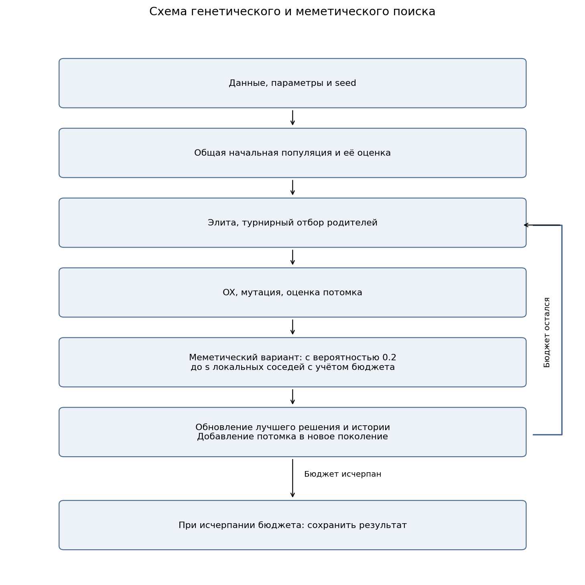

Схема показывает общий цикл. Новая элита выбирается при переходе поколения; потомки заполняют оставшиеся места. Достижение бюджета проверяется перед каждой оценкой, включая инициализацию и локальные попытки.

### 5. Параметры и бюджет

| Параметр | Значение |
|---|---:|
| Размер популяции | 80 |
| Элитных особей | 2 |
| Размер турнира | 3 |
| Вероятность кроссовера | 0,9 |
| Вероятность мутации | 0,3 |
| Вероятность локального поиска | 0,2 |
| Число локальных шагов | 5; дополнительно 1 |
| Бюджет запуска | 20000 |
| Интервал истории | 200 оценок |
| Seed основной серии | 1000–1029 |

Одна оценка означает полный расчёт качества одного кандидата. В бюджет входят 80 начальных особей, все потомки и принятые либо отклонённые локальные соседи. Повторно вычисленный дубликат тоже считается. Передача уже известной оценки элиты не требует вычисления. Кэш и скрытый ремонт отсутствуют.

Общая функция assess проверяет лимит и обновляет счётчики, лучший результат и историю. По достижении бюджета поиск останавливается и в середине поколения либо локального поиска. Лучший результат хранится независимо от популяции. Ранняя остановка по стагнации не используется.

Для инициализации, вариации и локального поиска применяются отдельные локальные генераторы. При одном seed методы начинают с одинаковой популяции. Между разными seed запуски независимы; сравнение методов при одинаковом seed является парным.

Бюджет оценок одинаков, число поколений и время могут различаться. Послепроверка найденного решения не является поиском, выполняется отдельно и не влияет на результат.

### 6. Проверка корректности

Выполнены 16 автоматических тестов ([протокол](results/test_output.txt)). Проверены:

- расстояния, ожидание, обслуживание, опоздание, загрузка и возврат на ручном примере;
- точное попадание на границы окна, вместимости и рабочего дня, пустая машина;
- независимый прямой расчёт 100 случайных решений;
- сохранение перестановки, суммы размеров и неизменность родителей при операторах;
- приоритет допустимости над длиной;
- точное число вызовов оценки, включая отклонённых соседей;
- сохранение лучшего при неполном поколении;
- повторяемость seed и общая инициализация методов;
- корректность всех контрольных маршрутов;
- статистика при 0, 1 и нескольких допустимых результатах;
- состав полной серии, независимый пересчёт 210 решений, совпадение сводной таблицы и хешей данных и алгоритмов;
- отказ при пустой серии, неверной оценке, пропущенной точке истории и ошибке счётчика локального поиска.

Для отдельного экземпляра с 6 клиентами и 2 машинами перебраны 6! × 7 = 5040 перестановок и разбиений, включая пустые маршруты. Вместимость равна 3, спрос каждого клиента равен 1, обслуживание равно 1, окна [0, 25], H = 40. Найден точный минимум:

$$
L^*=2(2+\sqrt{2}+\sqrt{10})=13{,}152982445.
$$

Один оптимальный план содержит маршруты 0→1→2→3→0 и 0→4→5→6→0. Точный результат повторно получен независимым расчётом расстояний и ограничений в тесте. Полный перебор используется для контроля, в основные алгоритмы его результат не передаётся.

Оба алгоритма дополнительно запущены на этом примере с seed 1000 и бюджетом 20000. В обоих контрольных запусках получен допустимый результат 13,152982445, то есть разрыв с точным минимумом равен 0 с точностью вычислений. Это проверочный пример, а не отдельная статистическая серия сравнения методов. Итоги сохранены в results/tiny_ga_1000.json и results/tiny_memetic_1000.json.

Все 210 запусков повторены. Совпали решения, оценки, история поиска и счётчики. Время выполнения в эту проверку не входило.

### 7. Пилот и методика эксперимента

Первый пилот использовал полностью случайную популяцию: 2 метода × 3 экземпляра × 3 seed, бюджет 3000. Допустимых результатов не было: 0/18. После этого до основной серии введена общая смешанная инициализация.

Повторный пилот при прежних данных, seed 9001–9003 и бюджете 3000 дал 16/18 допустимых результатов: 6/6 на 20 клиентах, 6/6 на 40, 4/6 на 60. Это позволило оставить бюджет основной серии 20000. Оба пилота, их конфигурации и версии исходников сохранены отдельно. Изменение описано в PROTOCOL.md.

Основная серия содержит 180 запусков: 2 метода × 3 экземпляра × 30 seed. Дополнительная серия содержит 30 запусков на 40 клиентах с s = 1 при остальных неизменных параметрах. Всего 210 запусков и ровно 4,2 млн поисковых оценок. Результаты неудачных запусков не заменялись. После начала основной серии поведение алгоритмов не менялось.

Для допустимых результатов рассчитаны минимум, среднее, медиана, выборочное стандартное отклонение и максимум длины. Для неудачных отдельно представлены нарушения. Статистика длины является условной по допустимым результатам. Время и число поколений сохранены для всех запусков. При парном сравнении длины используются только seed, где оба метода дали допустимый итог; число таких пар указано.

Среда: python 3.14.0, matplotlib 3.10.8, numpy 2.5.4. Версии остальных зависимостей, платформа, параметры, хеши входных данных и снимок исходников приложены к серии. Суммарное измеренное время самих 210 поисков составило 96,36 с, без установки, визуализации и проверок. Время зависит от машины и нагрузки системы.

### 8. Результаты

#### Основное сравнение

Все значения длины и её разброса ниже рассчитаны по допустимым итогам. Обозначение МА означает меметический алгоритм с 5 шагами.

| n | Метод | Допустимых / 30 | Минимум | Среднее | Медиана | Ст. отклонение | Максимум |
|---:|---|---:|---:|---:|---:|---:|---:|
| 20 | ГА | 29 | 587,450 | 587,450 | 587,450 | 0,000 | 587,450 |
| 20 | МА | 30 | 587,450 | 587,450 | 587,450 | 0,000 | 587,450 |
| 40 | ГА | 30 | 957,135 | 972,427 | 966,122 | 12,800 | 1012,591 |
| 40 | МА | 30 | 911,220 | 937,191 | 940,440 | 12,614 | 960,109 |
| 60 | ГА | 18 | 1241,901 | 1377,887 | 1365,565 | 79,452 | 1507,797 |
| 60 | МА | 28 | 1185,866 | 1320,318 | 1321,103 | 60,121 | 1438,645 |

На 20 клиентах все успешные запуски пришли к одной длине с точностью вычислений. Это устойчивость наблюдаемого значения, но не доказательство глобальной оптимальности. У ГА seed 1023 остался недопустимым: превышение груза 3 и суммарное опоздание 28,173, v = 0,190136.

На 40 клиентах МА дал меньшую длину во всех 30 парных сравнениях. Медиана относительного улучшения (L_ГА − L_МА) / L_ГА составила 3,888%, среднее 3,608%. Эти числа рассчитаны по парам, поэтому не равны относительной разности двух отдельно рассчитанных медиан.

На 60 клиентах доля допустимых итогов выросла с 60% до 93,33%. Из 18 пар с допустимыми результатами обоих методов МА выиграл 15 и проиграл 3. Медиана парного улучшения равна 5,279%. Разные количества допустимых итогов не позволяют оценивать результат только по двум условным медианам длины.

У 12 неудач ГА на 60 клиентах среднее v = 0,042950. У 2 неудач МА среднее v = 0,030079. Здесь все неудачи связаны с опозданиями, превышений груза или срока возврата нет. Для МА seed 1002 суммарное опоздание равно 10,030, seed 1017 равно 11,227. Это недопустимые планы доставки, даже если их длины сравнительно невелики.

| n | Метод | Среднее время, с | Среднее число поколений | Среднее число локальных оценок |
|---:|---|---:|---:|---:|
| 20 | ГА | 0,384 | 256,0 | 0 |
| 20 | МА | 0,274 | 128,0 | 9971,6 |
| 40 | ГА | 0,437 | 256,0 | 0 |
| 40 | МА | 0,427 | 128,6 | 9926,0 |
| 60 | ГА | 0,614 | 256,0 | 0 |
| 60 | МА | 0,585 | 127,9 | 9989,7 |

Число поколений учитывает и последнее неполное формирование. При s = 5 около половины бюджета расходуется на локальные попытки, поэтому поколений примерно вдвое меньше. Время приведено как фактическая характеристика запуска, отдельный эксперимент на скорость с прогревом и случайным порядком методов не проводился. Из этой таблицы не следует устойчивое превосходство МА по времени.

#### Сходимость и устойчивость

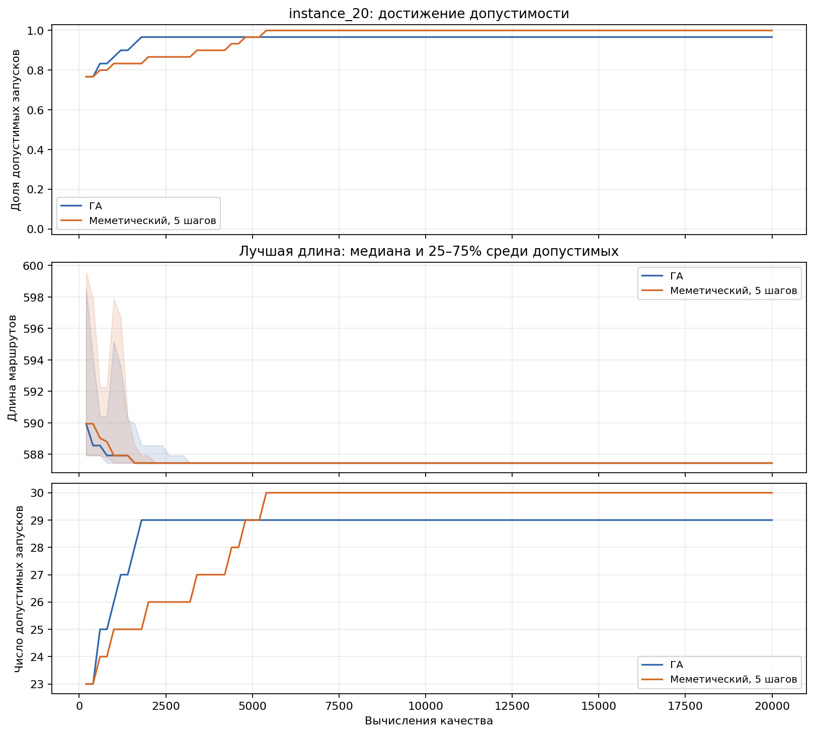

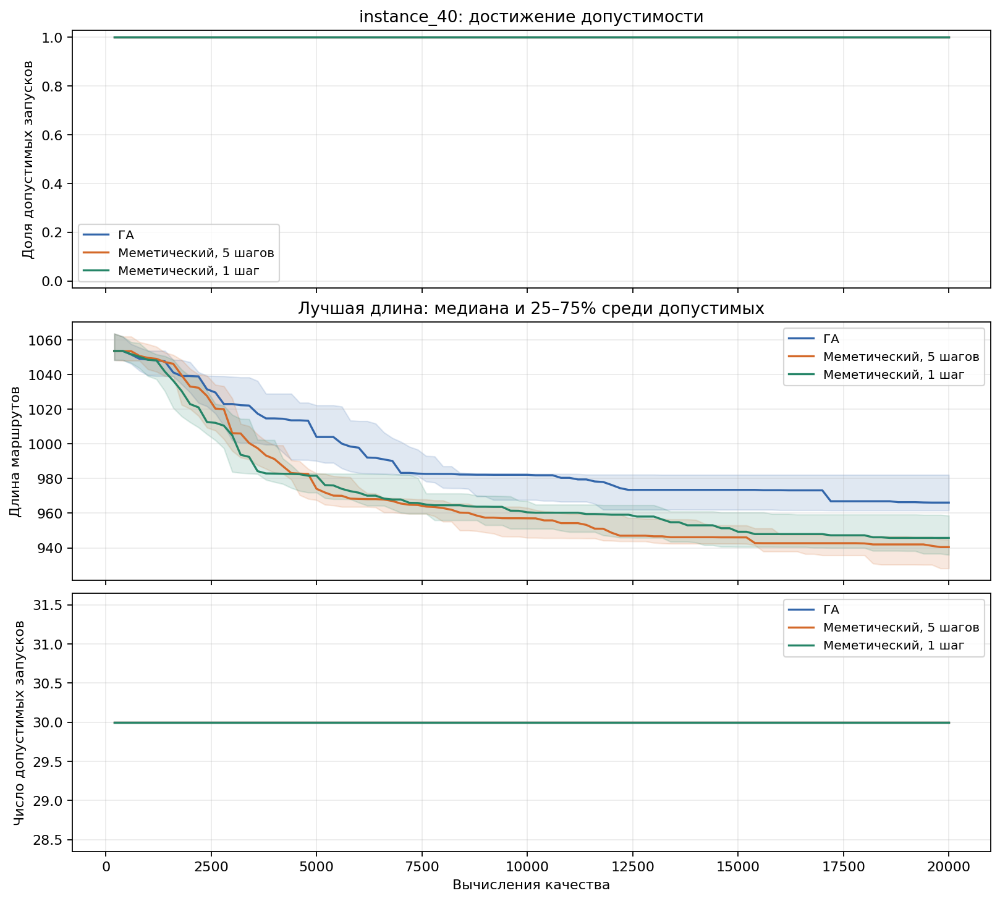

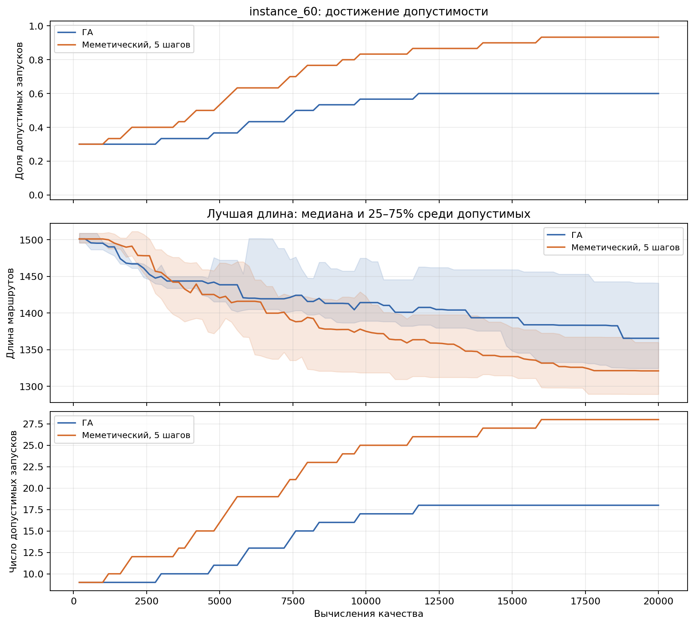

Верхняя часть показывает долю запусков, уже нашедших допустимое решение. В средней части показаны медиана и межквартильный диапазон лучшей допустимой длины. Число включённых запусков находится в нижней части. Это диапазон результатов, а не доверительный интервал. При изменении состава допустимых запусков условная медиана может временно возрастать, хотя лучший результат каждого отдельного запуска не ухудшается.

На 20 клиентах обычный ГА быстрее достигает большинства допустимых результатов, но один запуск не выходит из недопустимой области. На 60 клиентах МА продолжает увеличивать число успешных запусков после того, как ГА почти перестаёт находить новые допустимые решения. На 40 клиентах оба метода имеют допустимые решения с начала поиска, поэтому здесь сравнивается преимущественно улучшение длины.

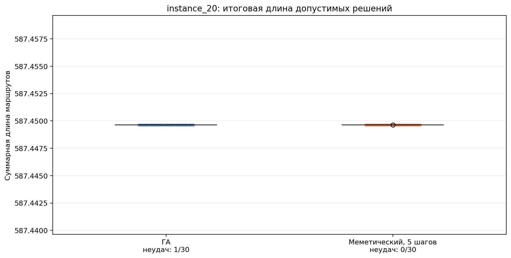

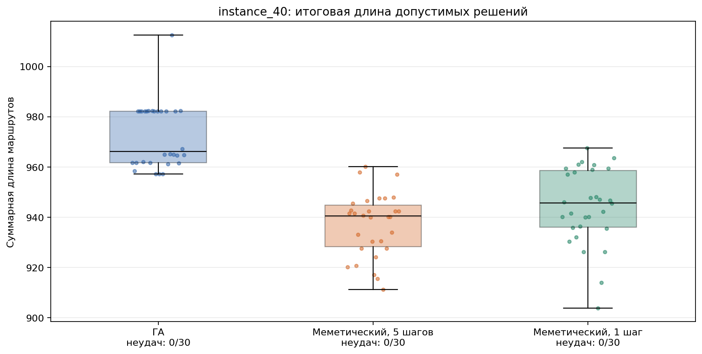

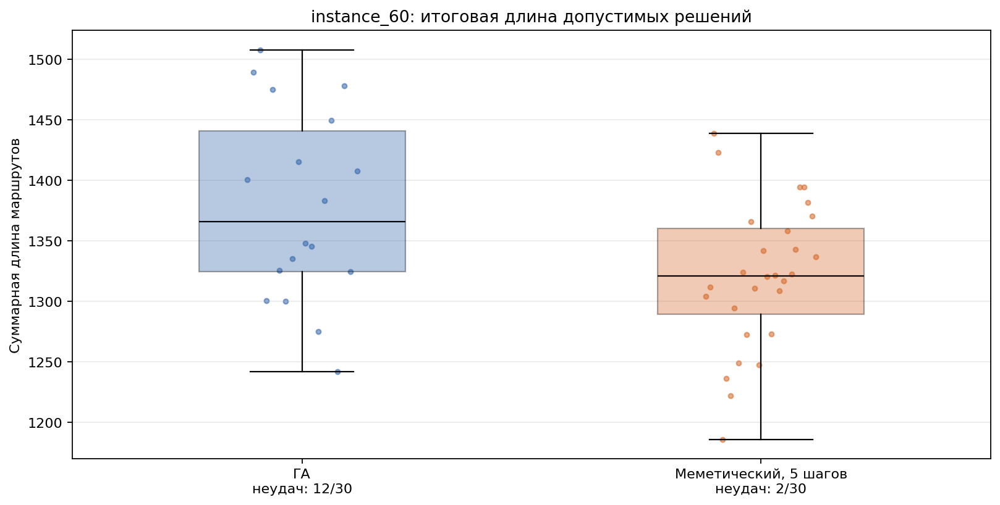

Точки показывают отдельные допустимые итоги, коробки показывают их разброс, число неудач подписано отдельно. На 20 клиентах коробки вырождаются в линию, поскольку длины практически одинаковы.

#### Вклад начальной популяции

| n | Запусков с допустимым начальным решением / 30 | Итог ГА | Итог МА | Медианное сокращение начальной допустимой длины, ГА / МА |
|---:|---:|---:|---:|---:|
| 20 | 23 | 29 | 30 | 0,503% / 0,503% |
| 40 | 30 | 30 | 30 | 7,832% / 11,069% |
| 60 | 9 | 18 | 28 | 11,283% / 14,859% |

Последний столбец рассчитан только по seed с допустимой начальной особью, а не по всей серии. Начальные результаты в каждой паре одинаковы. На 60 клиентах МА дополнительно вывел в допустимую область 19 запусков, ГА 9. Поэтому полученное различие не объясняется только готовыми начальными маршрутами.

#### Влияние числа локальных шагов

Для экземпляра на 40 клиентов изменён только параметр s. В обоих случаях вероятность локального поиска равна 0,2 и бюджет равен 20000.

| s | Допустимых / 30 | Минимум | Среднее | Медиана | Ст. отклонение | Максимум | Локальных оценок в среднем |
|---:|---:|---:|---:|---:|---:|---:|---:|
| 1 | 30 | 903,841 | 944,433 | 945,743 | 15,188 | 967,604 | 3319,9 |
| 5 | 30 | 911,220 | 937,191 | 940,440 | 12,614 | 960,109 | 9926,0 |

В 20 парах лучше s = 5, в 8 лучше s = 1, в 2 длины совпали с точностью 10⁻⁹%. Медианное парное преимущество 5 шагов относительно 1 равно 0,477%. У 1 шага лучший отдельный результат ниже, но среднее и медиана хуже, а разброс больше. Это показывает, почему выбор по единственному лучшему запуску был бы недостаточен. Значимость различий не проверялась; результат описывает данную серию.

### 9. Демонстрация найденных маршрутов

Выбраны допустимые запуски МА, ближайшие к медиане длины; при равенстве берётся меньший seed. Это seed 1000 для 20 клиентов, 1009 для 40 и 1016 для 60. Их длины равны 587,450; 940,717; 1320,590 соответственно.

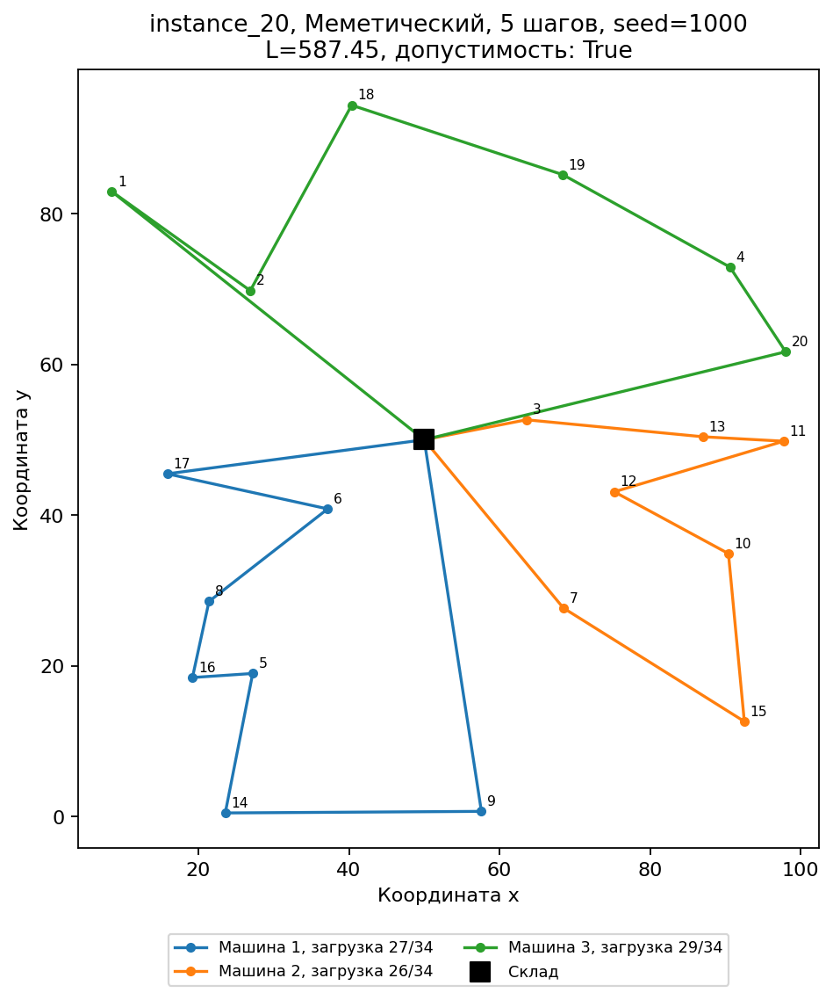

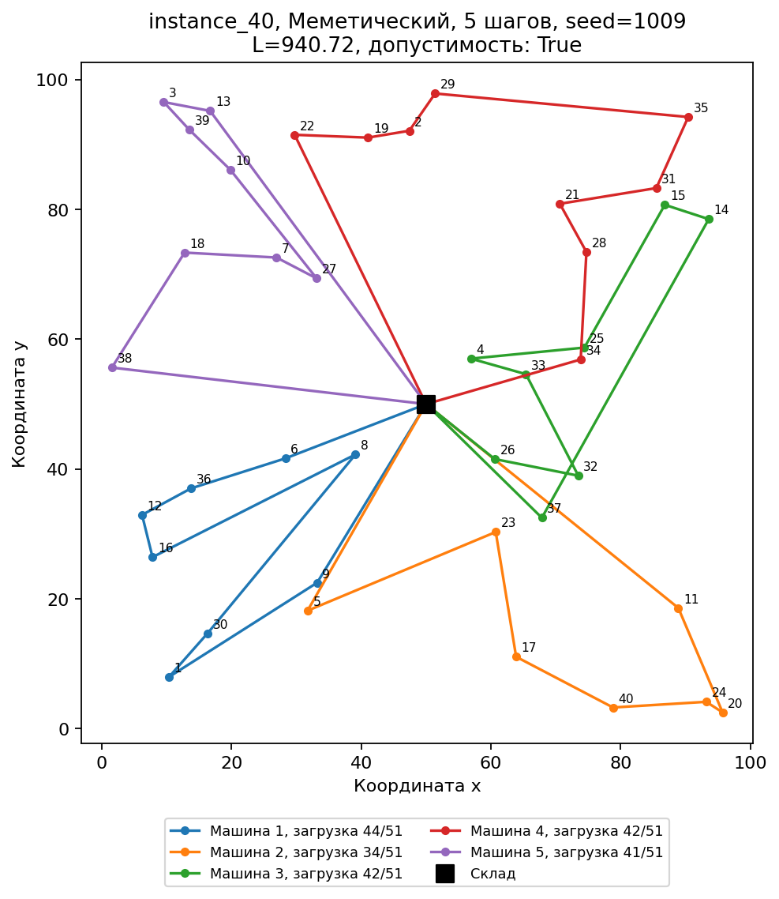

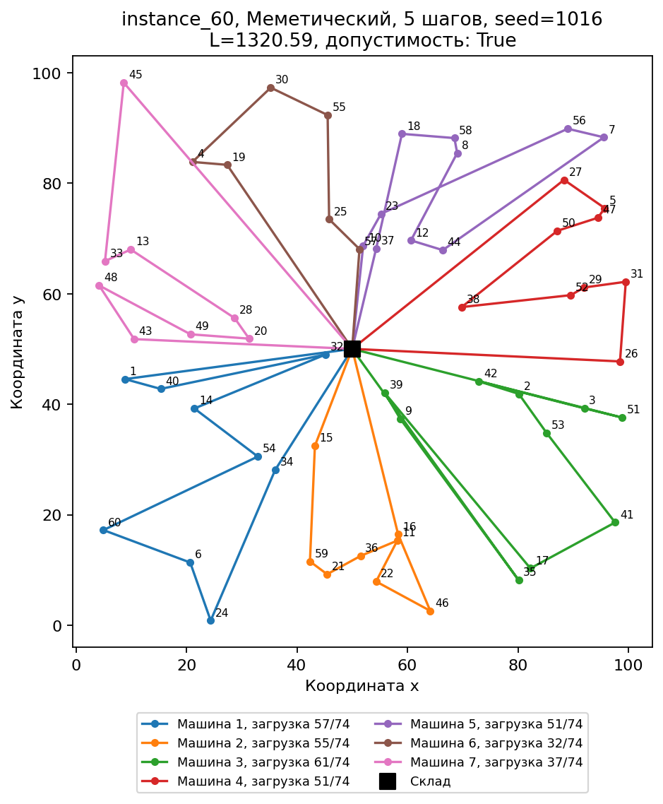

Разными цветами обозначены машины, квадратом склад, номерами клиенты. Пересечения линий сами по себе не означают ошибку: выбор порядка ограничен временными окнами. Точный порядок клиентов и моменты обслуживания сохранены в JSON.

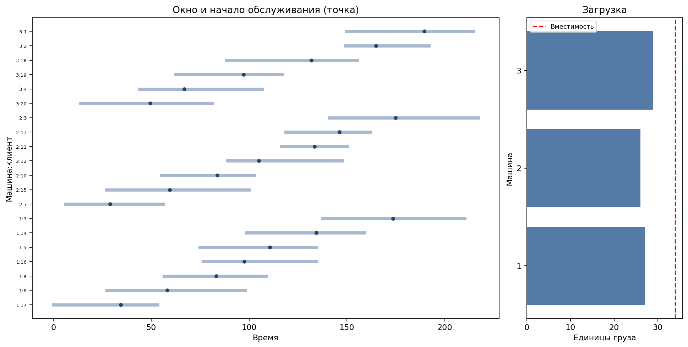

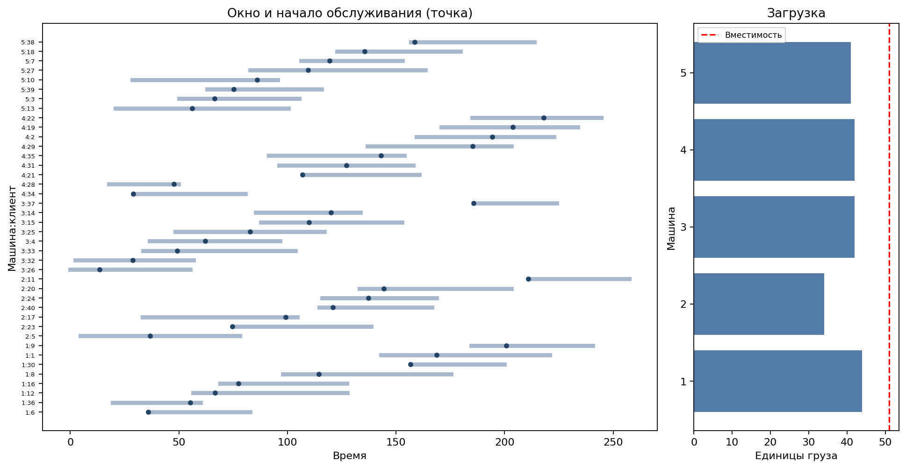

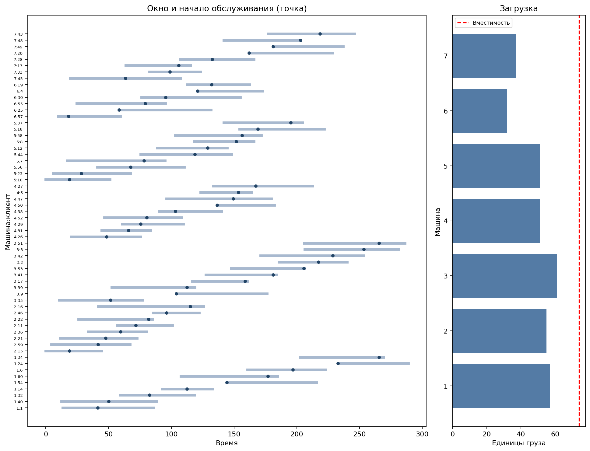

На временных диаграммах отрезок обозначает допустимое окно, точка начало обслуживания; слева подписаны машина и клиент. Диаграмма загрузки показывает запас относительно вместимости. Возврат дополнительно проверяется по полному расписанию, записанному для каждой машины.

### 10. Выводы и ограничения

На 40 клиентах меметический ГА сократил длину маршрутов во всех 30 парах запусков. Медианное сокращение составило 3,9%. На 60 клиентах допустимые маршруты найдены в 28 из 30 запусков меметического ГА и в 18 из 30 запусков обычного ГА. На 20 клиентах длины допустимых маршрутов совпали. На 40 клиентах пять локальных шагов дали меньшую медиану, чем один (940,44 против 945,74), хотя лучший отдельный результат получен с одним шагом.

Два запуска меметического ГА на 60 клиентах закончились опозданиями. План из такого запуска нельзя использовать для доставки по заданным окнам. На каждый размер взят один синтетический набор, а способ построения начальных маршрутов использует похожую разбивку клиентов. Следующий шаг: повторить сравнение на других наборах и с другими окнами.

### Материалы и воспроизведение

Постановка и требования взяты из методички Р. В. Душкина «Дисциплина „Эволюционное программирование и генетические алгоритмы“. Комплекс лабораторных работ», разделы 1 и «Лабораторная работа №4». Данные синтетические, внешние измерения не использовались.

Исходники находятся в корне проекта. Установка и команды приведены в README.md, порядок чтения в HOW_TO_READ.md, сценарий демонстрации на 5–7 минут в DEMO.md. Полные числа без округления находятся в results/main/summary.csv, парные сравнения в paired.csv, отдельные итоги в runs.csv и JSON. Конфигурация серии и снимки исходников приложены, пилоты сохранены отдельно.
